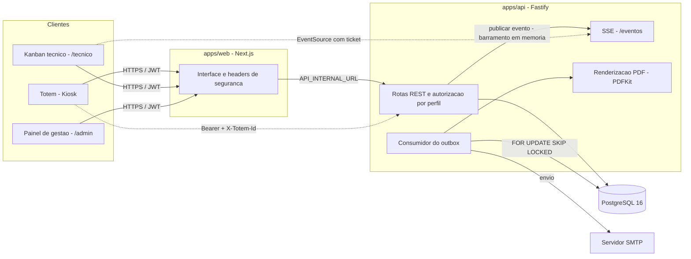
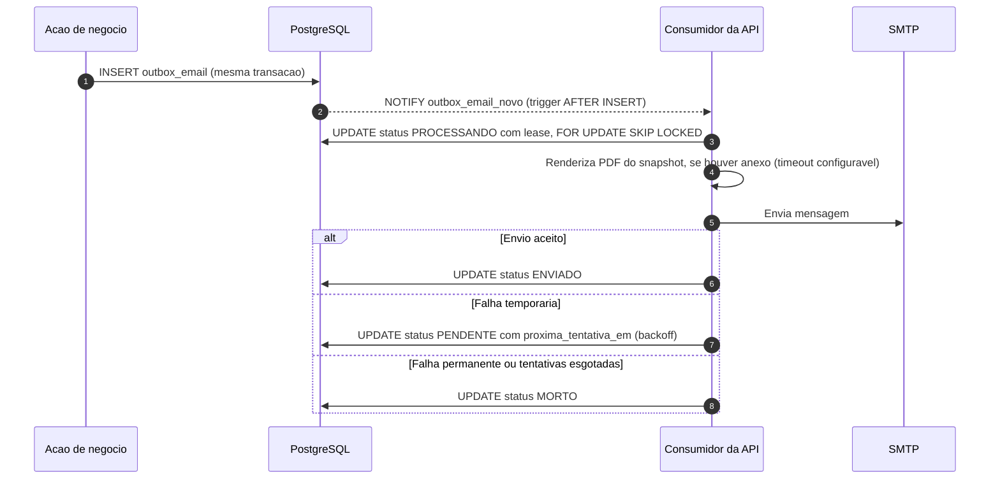
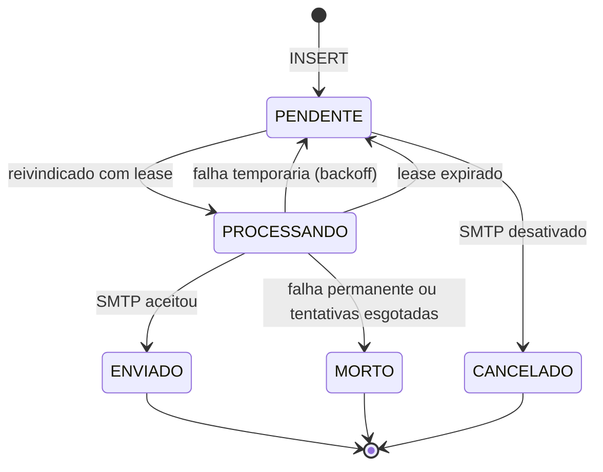
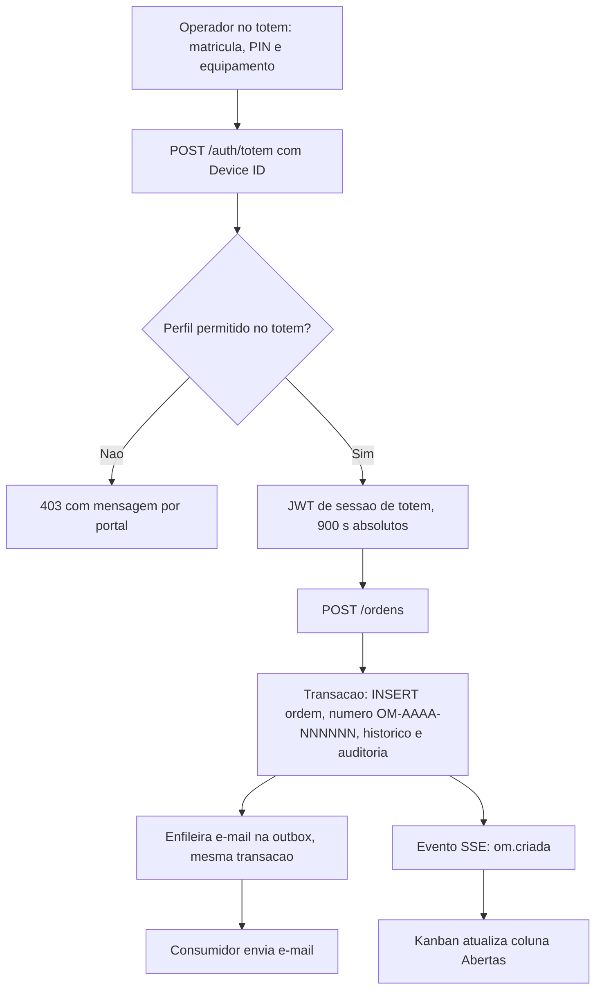

# Arquitetura

Este documento descreve a arquitetura do CMMS Industrial conforme implementada no código: componentes, ciclo de vida da Ordem de Manutenção (OM), padrão Transactional Outbox para e-mail e numeração anual atômica.

---

## 1. Visão geral dos componentes

| Componente | Responsabilidade |
|---|---|
| `apps/web` | Totem (kiosk), Kanban do técnico e painel de gestão. Aplica headers de segurança via `next.config.ts`. |
| `apps/api` | API REST (Fastify), autenticação JWT, autorização por perfil, SSE, geração de PDF e consumidor do outbox. |
| PostgreSQL 16 | Fonte da verdade: OMs, histórico de status, auditoria, sequências anuais e fila de e-mail. |
| `db/migrations` | Evolução do schema em SQL versionado, aplicado pelo `db/migrate.sh`. |
| SMTP | Entrega de notificações. Não é consultado na transação de negócio. |

### 1.1 Camadas da API

A API é montada em `apps/api/src/app.ts`:

1. **Público:** `/health*`, `/metrics`, `/auth/*`, `/config/publica` (sem autenticação) e `/eventos` (autenticado por ticket de uso único).
2. **Protegido:** todas as demais rotas passam pelo hook `autenticar`, que valida o JWT e, em sessões de totem, o Device ID.
3. **Autorização:** cada rota declara o perfil exigido por `preHandler` (ver [SECURITY_RBAC.md](SECURITY_RBAC.md)). O perfil e o estado `ativo` são relidos no banco a cada chamada.

---

## 2. Ciclo de vida da OM

Os estados abaixo são os valores do enum `StatusOrdem` (Prisma e `status_ordem` no banco) e as transições reais implementadas nas rotas de `apps/api/src/routes/atendimento.ts`.

```mermaid
stateDiagram-v2
    [*] --> ABERTA: POST /ordens

    ABERTA --> EM_ANDAMENTO: assumir (TECNICO)
    ABERTA --> RESERVADA: atribuir (GERENTE / ADMIN)

    RESERVADA --> EM_ANDAMENTO: assumir pelo tecnico designado
    RESERVADA --> ABERTA: recusar (TECNICO)
    RESERVADA --> ABERTA: cancelar-delegacao (GERENTE / ADMIN)
    RESERVADA --> ABERTA: expiracao sem aceite (job fallback)

    EM_ANDAMENTO --> PAUSADA: pause (TECNICO)
    PAUSADA --> EM_ANDAMENTO: play (TECNICO)
    AGUARDANDO_PECA --> EM_ANDAMENTO: play (TECNICO)

    EM_ANDAMENTO --> AGUARDANDO_APROVACAO: concluir (TECNICO)
    PAUSADA --> AGUARDANDO_APROVACAO: concluir (TECNICO)
    AGUARDANDO_PECA --> AGUARDANDO_APROVACAO: concluir (TECNICO)

    AGUARDANDO_APROVACAO --> AGUARDANDO_BAIXA: aprovar (OPERADOR / LIDER_PRODUCAO / ADMIN)
    AGUARDANDO_APROVACAO --> EM_ANDAMENTO: reprovar com motivo

    AGUARDANDO_BAIXA --> CONCLUIDA: encerrar (GERENTE / ADMIN)

    CONCLUIDA --> [*]

    CANCELADA: CANCELADA (existe no enum; nenhuma rota de transicao a grava)
```

### 2.1 Observações sobre o ciclo

- **`AGUARDANDO_PECA`** é um estado legado: continua aceito nas transições de execução e é exibido como *pausado* no Kanban. Novas pausas gravam `PAUSADA` com o motivo em `motivo_pausa`.
- **`RESERVADA`** é uma delegação do gestor a um técnico. Se o técnico não aceitar dentro do prazo, o job `jobs/fallback.ts` devolve a OM para `ABERTA` e dispara alerta uma única vez por OM (`fallback_alertado_em`).
- **Aprovação não é conclusão.** O aprovador move a OM para `AGUARDANDO_BAIXA`; apenas o gestor encerra (`CONCLUIDA`). Isso separa o aceite técnico da baixa administrativa.
- **Histórico:** cada transição relevante grava uma linha em `historico_status_ordem` (`statusAnterior` → `statusNovo`), usada pelas métricas de desempenho.
- **Estados no Kanban:** o mapeamento para as colunas do Kanban (`ABERTO`, `EM_ATENDIMENTO`, `PAUSADO`, `AGUARDANDO_APROVACAO`, `AGUARDANDO_BAIXA`, `CONCLUIDO`, `CANCELADO`) está em `atendimento.ts`.

### 2.2 Concorrência nas transições

As transições são feitas com `UPDATE ... WHERE id = ? AND status = '<estado esperado>'`. Se duas requisições competirem pela mesma OM, apenas uma altera a linha; a outra recebe `409 OM_NAO_DISPONIVEL`. Assim, não há dupla atribuição nem transição inválida por corrida.

---

## 3. Transactional Outbox para e-mail

Enviar e-mail diretamente dentro da transação de negócio causaria dois problemas: o e-mail sairia mesmo se a transação fosse revertida, e uma falha do SMTP derrubaria a ação do usuário. O projeto usa o padrão **Transactional Outbox**.

### 3.1 Produtor

A notificação é gravada na tabela `outbox_email` **na mesma transação** da ação de negócio (`enfileirarEmail(tx, ...)` em `apps/api/src/mail/outbox.ts`). Se a transação der rollback, a linha desaparece junto. Um anexo de ficha em PDF é gravado como snapshot (`outbox_anexo`), não como uma consulta viva à OM.

### 3.2 Consumidor

### 3.3 Garantias e mecanismos

| Mecanismo | Implementação |
|---|---|
| Atomicidade produtor | Gravação na mesma transação da ação de negócio. |
| Acordar o consumidor | `LISTEN`/`NOTIFY` (trigger em `INSERT` e em mudança de `status`). O NOTIFY só acorda; a tabela é a fonte da verdade. |
| Rede de segurança | Polling periódico (`OUTBOX_EMAIL_POLL_SEG`) cobre NOTIFY perdido e leases expirados. |
| Concorrência entre réplicas | `FOR UPDATE SKIP LOCKED` na reivindicação de lote. |
| Lease | Coluna `bloqueado_ate` com `bloqueado_por`. Lease expirado volta a `PENDENTE`. Restrição de banco garante coerência entre `status = PROCESSANDO` e o lease. |
| Retentativas | Backoff por tentativas feitas: 5 s, 30 s, 2 min, 10 min, 1 h e 6 h, com jitter de ±20 %. Limite em `OUTBOX_EMAIL_MAX_TENTATIVAS` (padrão 6). |
| Entrega | *At-least-once*: uma queda entre o aceite do SMTP e o `UPDATE ENVIADO` pode reenviar. Nunca perde mensagem. |
| Imutabilidade | Trigger `fn_outbox_email_imutavel` impede alterar destinatário, assunto, corpo e tipo depois de criada a linha, e bloqueia transições proibidas a partir de estados terminais (`ENVIADO`). |
| Expurgo | Função `fn_outbox_email_expurgar` remove linhas `ENVIADO`, `CANCELADO` e `MORTO` após o prazo de retenção. |
| Desligamento | Ao parar, o consumidor para de reivindicar lotes e aguarda envios em curso por até `OUTBOX_EMAIL_SHUTDOWN_SEG`. |

### 3.4 Estados da linha

---

## 4. Numeração anual atômica `OM-AAAA-NNNNNN`

Cada OM recebe um número legível por pessoas, único e reiniciado a cada ano civil. Exemplo: `OM-2026-000042`.

### 4.1 Peças do banco

| Objeto | Função |
|---|---|
| Tabela `om_sequencias_anuais` | Uma linha por ano, com `ultimo_numero`. Restrições: ano entre 2000 e 2100 e último número não negativo. |
| Função `fn_proximo_numero_om(ano)` | `INSERT ... ON CONFLICT (ano) DO UPDATE SET ultimo_numero = ultimo_numero + 1` e retorna o novo valor. |
| Trigger `trg_ordens_numero_formatado` | `BEFORE INSERT` em `ordens_manutencao`. Se `numero_formatado` vier nulo, calcula o ano no fuso `America/Sao_Paulo`, obtém o próximo sequencial e formata com `lpad` de 6 dígitos. |

### 4.2 Por que é atômico

- O incremento acontece **dentro da mesma transação** do `INSERT` da OM. Se a criação falhar, o `ROLLBACK` desfaz o incremento e não há buraco na numeração.
- Requisições concorrentes disputam a mesma linha de `om_sequencias_anuais`. O `ON CONFLICT ... DO UPDATE` serializa essas atualizações, e cada transação recebe um número distinto.
- A restrição `UNIQUE` em `ordens_manutencao.numero_formatado` impede duplicidade mesmo em caso de erro de lógica.
- A virada do ano usa o ano de `data_abertura` (no fuso de São Paulo), e a sequência do novo ano começa em 1.

---

## 5. Fluxo de dados da abertura de uma OM

---

## 6. Decisões técnicas

| Decisão | Motivo |
|---|---|
| Fastify com Zod | Validação de entrada no limite da API, com resposta `400 VALIDACAO` e detalhes por campo. |
| Prisma para leitura e escrita comum; SQL bruto nas transições | Transições críticas usam `UPDATE ... WHERE status = ...` e `FOR UPDATE`, que exigem controle explícito. |
| Migrations SQL próprias | Triggers, funções, índices parciais e restrições (`CHECK`) ficam versionados junto do banco. |
| SSE com ticket de uso único | `EventSource` do navegador não envia cabeçalho `Authorization`; o ticket de 30 s evita expor o JWT na URL. Os eventos são distribuídos por um barramento em memória (`events.ts`), o que limita o stream a uma única instância da API. |
| Rate limit por rota | Limites mais restritos em `/auth/*` e em ações sensíveis (aprovar, reprovar, assumir). |
| Limitações conhecidas | Bloqueio de PIN e o barramento de eventos (`events.ts`) são em memória. Com mais de uma instância da API, é preciso migrar para Redis ou para um serviço compartilhado. |

---

## 7. Documentos relacionados

- [SECURITY_RBAC.md](SECURITY_RBAC.md): perfis, autenticação, headers, CSV e PDF.
- [API_REFERENCE.md](API_REFERENCE.md): endpoints e exigências de perfil.
- [DEPLOYMENT.md](DEPLOYMENT.md): execução em Linux com Docker e TLS.
